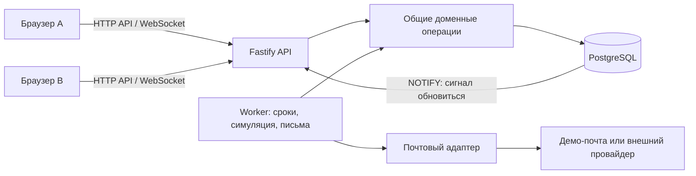
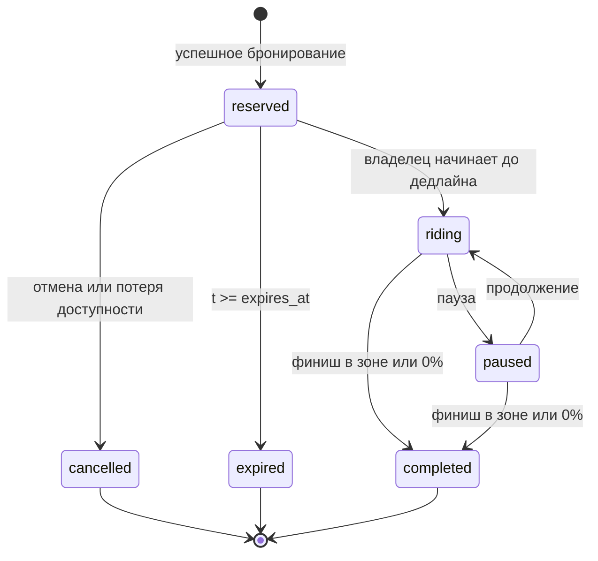

# СамоКеттик — архитектура для согласования

> Актуализация U008: историческое предложение E0 о пропорциональной оплате ниже заменено реализованным ceil-per-mode-v1, см. [BILLING.md](BILLING.md). Реальная зона — config/service-zone.json (полный OSM relation 8493930); остальные открытые вопросы не считаются согласованными автоматически.

Статус U010: **реализованы каркас, серверные бронирования/поездки/billing, постоянная симуляция, WS и локальный mailbox**. Точные действующие правила и отклонения от исходных предложений ниже — [SIMULATION-REALTIME.md](SIMULATION-REALTIME.md), [BILLING.md](BILLING.md), [REALTIME-REPORT.md](REALTIME-REPORT.md). Продуктовые UI/auth/RU-KY и внешняя почта остаются открытыми. Следующие разделы сохраняют проект E0; где они расходятся с принятыми D38–D48, действуют новые решения. Фактическое состояние — [отчёт каркаса](FOUNDATION-REPORT.md) и [отчёт бронирования](RESERVATIONS-REPORT.md). Связанные документы: [требования](REQUIREMENTS.md), [решения](DECISIONS.md), [этапы](IMPLEMENTATION-PLAN.md), [журнал](WORKLOG.md), [промпты](PROMPTS.md), [источники](SOURCES.md).

## Что обнаружено в рабочей папке на этапе E0

Исходников, package.json, миграций, тестов и `.git` нет. До начала работы присутствовали только пустые `work/` и `outputs/`. Это новая рабочая папка, а не существующий Git-репозиторий. Проверено также отсутствие Git-корня в родительском `Documents/Codex`.

Доступны Git, Node.js 22.14.0, npm 10.9.2, Docker CLI 28.3.2 и ripgrep. Docker Engine недоступен: отсутствует pipe `dockerDesktopLinuxEngine`. База, контейнеры, браузерные и функциональные тесты не запускались. Глобальная Git-идентичность: `Reen <rinni499@gmail.com>`; её надо повторно проверить перед первым коммитом. Инициализация репозитория, коммиты, установка пакетов и запуск сервисов на этом этапе не выполнялись.

## Границы решения

Цель за три дня — локально воспроизводимая демонстрация полного цикла аренды, включая реальные конкурентные запросы к PostgreSQL. Это не управление физическими замками, не промышленный биллинг и не реальный эквайринг. Требования задания не исключаются из-за срока; внешние зависимости и неподтверждённые пункты остаются видимыми.

Предлагаю npm workspaces без Nx/Turborepo; React/Vite frontend; Fastify backend; PostgreSQL; два процесса из одного backend-проекта: `api` и `worker`. Worker и API вызывают одни и те же доменные операции. Отдельные микросервисы, Redis, Kafka, event sourcing и Kubernetes не нужны для этой нагрузки.



Схема показывает зависимости, а не отдельные развёртываемые сервисы для каждого блока. В Compose: frontend, api, worker, postgres и одноразовый migrate; почтовый сервис добавляется только после выбора способа отправки. PostgreSQL имеет именованный volume. API и worker не применяют миграции при каждом старте параллельно.

## Стек и обоснование

| Область | Предложение | Причина / ограничение |
| --- | --- | --- |
| Frontend | React + TypeScript + Vite | Соответствует предпочтениям; SPA достаточно, SSR не нужен |
| Авторские стили | Sass, компонентные `.module.scss`, общие `@use`/`@forward` | Выполняет глобальное требование пользователя и позволяет создать самостоятельный UI |
| Доступные примитивы | Radix по необходимости, адаптированные компоненты на его основе | Подход shadcn без переноса готового внешнего вида и utility-зависимостей |
| Tailwind/shadcn | Предлагаю не включать Tailwind и готовые Tailwind-шаблоны shadcn | Tailwind v4 не рассчитан на совместный pipeline с Sass; два способа авторских стилей здесь избыточны. Это отклонение от предпочтительного стека требует согласования [S8] |
| Backend | Node.js 24 LTS в контейнере, Fastify + TypeScript strict | Обычный долгоживущий процесс удобен для WS. Локальный Node 22.14.0 зафиксирован как факт, а не целевой runtime [S9] |
| Контракты | TypeBox + штатная Ajv-валидация Fastify, response schemas | Один источник DTO и runtime-проверок; без параллельной Zod-схемы. Контракт не экспортирует ORM-таблицы [S6] |
| БД | PostgreSQL 18, Drizzle + `pg`, SQL-миграции в Git | Транзакции, ограничения, SQL для блокировок; ORM не скрывает критические запросы. Поддерживаемая major-версия, patch/image digest фиксируются на этапе окружения [S7, S10] |
| Realtime | `@fastify/websocket`, HTTP-команды, WS-уведомления | Один путь изменения состояния; WS не становится вторым командным API |
| Карта | Leaflet + OpenStreetMap tiles | Простая карта, GeoJSON зоны, 30 маркеров; PostGIS и кластеризация пока не нужны |
| Тесты | Vitest + настоящий PostgreSQL; Playwright | Unit для арифметики/геометрии, интеграционные для гонок, браузерные для клиентов |
| Локальный запуск | Docker Compose + npm lockfile | Отдельные сетевые frontend/backend, воспроизводимая БД и миграции |

Точные совместимые версии React/Vite/Fastify/Drizzle и остальных пакетов будут проверены и зафиксированы при установке, не предполагаются проверенными сейчас. `strict`, `noUncheckedIndexedAccess`, явное преобразование DB bigint и проверка неизвестных JSON обязательны. Не добавлять зависимости «на будущее». Для паролей — Argon2id, для Google OIDC — поддерживаемая библиотека проверки токенов; криптографию самостоятельно не реализовывать.

## Структура проекта

```text
apps/
  web/
    src/
      app/                 # bootstrap, маршруты, провайдеры
      api/                 # HTTP client, WS invalidation, восстановление
      features/
        auth/              # вход, регистрация, Google
        fleet/             # карта, маркеры, выбор транспорта
        rental/            # бронь, поездка, пауза, таймер
        history/           # поездки, счета, демо-оплата
        notifications/     # постоянные уведомления
      components/          # общие доступные примитивы
      locales/             # ru, ky
      styles/              # _tokens.scss, _mixins.scss, _base.scss, main.scss
  server/
    src/
      entrypoints/         # api.ts и worker.ts
      config/              # env и бизнес-настройки с валидацией
      db/                  # schema, соединение, транзакции
      modules/
        auth/
        fleet/
        rentals/           # единый агрегат брони/поездки
        billing/
        notifications/
        realtime/
        simulation/
      jobs/                # циклы, outbox, readiness worker
      shared/              # ошибки, время, журналирование
    drizzle/               # проверяемые SQL-миграции
packages/
  contracts/src/           # HTTP/WS DTO, error codes, public config
config/
  demo.json                # несекретные бизнес-настройки
  service-area.geojson     # версия зоны и источник
tests/
  integration/             # PostgreSQL, API, гонки, рестарты
  e2e/                     # два BrowserContext, RU/KY, responsive
docs/
  WORKLOG.md
  DECISIONS.md
  PROMPTS.md
  REQUIREMENTS.md
  ARCHITECTURE.md
  IMPLEMENTATION-PLAN.md
  SOURCES.md
  prompts/
  design-research/          # появится на этапе UI
compose.yaml
.env.example
README.md
package.json
package-lock.json
```

Не создавать пустые слои repository/service/controller для каждого файла. Модуль содержит routes, schemas, операции и SQL-доступ по мере необходимости. Общие доменные операции получают транзакцию и серверное время, но не зависят от HTTP или React. Backend-арифметика не переносится в клиент как авторитетный расчёт.

## Конфигурация

Секреты и адреса — env, бизнес-параметры — один валидируемый `config/demo.json`. API и worker вычисляют hash одной конфигурации; при несовпадении readiness не проходит. Динамического редактирования тарифов в MVP нет. БД хранит снимки правил, нужные для восстановления уже начатых операций. Frontend получает только публичную часть через API.

| Параметр | Значение / статус |
| --- | --- |
| `productName`, `city`, `timezone`, `currency` | СамоКеттик, Бишкек, Asia/Bishkek, KGS |
| `locales`, `defaultLocale` | ru, ky; ru |
| `rideRateMinorPerMinute` | 800 тыйын = 8 сом |
| `pauseRateMinorPerMinute` | 200 тыйын = 2 сом |
| `reservationDurationSeconds` | 900 |
| `reservationWarningBeforeSeconds` | 180 |
| `minRentalBatteryBp` | 1500 = 15,00% |
| `simulationTickMs` | 3000 |
| `fleetSize` | 30 |
| `serviceAreaFile`, `serviceAreaVersion` | Согласованный GeoJSON всей демо-зоны Бишкека |
| `billingPolicy` | Предлагается пропорционально длительности, округление суммы один раз |
| `rideDrainBpPerMinute`, `pauseDrainBpPerMinute` | Предлагается 100 и 20; это новые демо-параметры, не требования заказчика |
| `simulationSpeedMps`, `simulationSeed` | Предлагается 4 м/с и фиксированный seed |
| `jobPollMs`, `reconcileMs` | Предлагается 1000 и 5000; не обещание точности таймеров ОС |
| `mailMode`, `mailRetryPolicy` | Требует выбора, см. раздел о письмах |

Есть также валидируемые технические настройки heartbeat, idle timeout, максимальных размеров запросов, пула БД, rate limit, срока сессии и лимита retry. Числа не копируются по модулям. Бронь сохраняет фактический `expires_at`, warning — `warn_at`; поездка — тариф, rounding policy, коэффициенты разряда/движения и версию зоны. Перезапуск с новой конфигурацией не переоценивает прошлую поездку.

## Неоднозначности и предлагаемые правила

Все пункты ниже — предложения для одобрения, а не уже полученные ответы.

| Вопрос | Предлагаемое правило | Почему существенно |
| --- | --- | --- |
| Что означает «по минутам»? | Пропорционально фактической длительности; тариф задан за минуту; финальная сумма округляется до тыйына один раз | Альтернатива — каждая начатая минута, даёт другую цену |
| Есть ли плата за бронь/разблокировку? | Нет; отмена и истечение брони бесплатны | Не добавлять неуказанные комиссии |
| Сколько активных аренд у пользователя? | Одна бронь **или** одна поездка | Исключает занятие всего парка одним аккаунтом |
| Старт без брони? | Только из собственной действующей брони | Меньше переходов и однозначный сценарий |
| Долг блокирует аренду? | Предлагается блокировать новую бронь при неоплаченном счёте | Оплата после поездки получает понятный смысл; завершению долг не мешает |
| Бронь ровно на дедлайне? | Действительна при `t < expires_at`; при равенстве уже истекла | Проверка времени после получения блокировок |
| Предупреждение, если клиент offline? | Постоянное in-app уведомление; после подключения видна актуальная информация | Нельзя гарантировать показ отключённому браузеру без push; email для warning не требуется |
| Worker отсутствовал всё окно warning? | Если срок уже истёк, только уведомление об истечении; не отправлять устаревшее «осталось 3 минуты» | Устранение вводящих в заблуждение сообщений |
| Заряд при паузе/брони? | Пауза расходует меньше; бронь и свободный транспорт сами не разряжаются в базовой симуляции | Прозрачное демо; тех.сценарий умеет принудительно уменьшить заряд |
| В бронь заряд упал ниже 15%? | Отменить бронь с причиной; на старте снова проверить порог | Не запускать поездку на недопустимом заряде |
| Точно 15% и продолжение при <15%? | При 15% бронирование разрешено; начатая поездка продолжается до 0% | Порог старта отличается от причины автостопа |
| Пауза вне зоны? | Допустима, как и движение; обычное завершение только в зоне | В ТЗ запрещено именно завершение |
| 0% вне зоны? | Принудительно завершить независимо от зоны; самокат недоступен | Приоритет остановки разряженного транспорта; причина сохранена |
| Что такое «весь Бишкек»? | Согласованный Polygon/MultiPolygon, включая граничную линию | Bounding box не является городом. Административная граница и коммерческая зона могут различаться |
| Простой backend/БД? | Симуляционное время продолжается; worker при восстановлении доигрывает интервал, не начисляя после расчётного 0% | Альтернатива — заморозка симуляции/оплаты при серверном сбое. Это отдельное продуктовое решение |
| Письмо ровно один раз? | Строго — одно письмо в идемпотентном демо-почтовом транспорте; для реальной почты согласовать ограниченную гарантию | Одна outbox-запись не равна отсутствию дубликатов у SMTP-получателя |
| Google | Настоящий Google OIDC при предоставленных credentials и разрешённом callback | Локальная кнопка-заглушка не выполняет требование |

Не предполагаются права администратора или физический GPS пользователя: движение и координаты транспорта генерирует сервер. Для проверок 0%, выхода из зоны и сбоев нужны test fixtures/локальная CLI-команда, доступные только в demo/test режиме, не публичные незащищённые API.

## Модель данных PostgreSQL

UUID — идентификаторы сущностей, `timestamptz` — абсолютное время, UTC внутри. ISO 8601 на границе API, отображение через `Asia/Bishkek`. DB `bigint` передаётся строкой либо явно безопасно преобразуется, без случайного переполнения JavaScript Number. PostgreSQL не сохраняет название часового пояса внутри `timestamptz`; оно задаётся отдельно в конфигурации.

Бронь и поездка — один агрегат `rentals`. Так можно ограничить занятие транспорта и пользователя одним индексом на каждую сущность, без гонки между двумя разными таблицами.

| Таблица | Основные поля | Ограничения / назначение |
| --- | --- | --- |
| `users` | id, email_normalized, password_hash nullable, locale, created_at | UNIQUE(email_normalized), password hash не выдаётся API |
| `oauth_identities` | id, user_id, provider, subject | UNIQUE(provider, subject); не связывать аккаунты автоматически только по совпадению email |
| `sessions` | token_hash PK, user_id, expires_at, revoked_at | В БД только hash случайного токена; индекс по сроку/пользователю |
| `service_area_versions` | id/version, geojson jsonb, source, checksum | Неизменяемая версия зоны; проверка GeoJSON при загрузке |
| `vehicles` | id, public_code, service_mode, battery_bp, lat_e7, lon_e7, simulation_at, simulation_state jsonb, version | UNIQUE(public_code); CHECK battery 0..10000, latitude/longitude bounds, mode operational/maintenance |
| `rentals` | id, user_id, vehicle_id, state, reserved_at, warn_at, expires_at, started_at, ended_at, end_reason, rate snapshots, simulation snapshots, service_area_version, version | Состояния reserved/riding/paused/completed/cancelled/expired; CHECK зависимостей времён и terminal state |
| `rental_intervals` | id, rental_id, mode, started_at, ended_at nullable | riding/paused; ended_at >= started_at; один открытый интервал на rental |
| `invoices` | id, rental_id, user_id, amount_minor bigint, currency, active_ms bigint, paused_ms bigint, billing_policy, issued_at, paid_at nullable | UNIQUE(rental_id), amount >= 0; сумма и длительности после выпуска неизменяемы |
| `payment_attempts` | id, invoice_id, user_id, outcome, created_at | success/declined; частичный UNIQUE(invoice_id) для success; stub не принимает реальные карты |
| `notifications` | id, user_id, logical_key, code, payload jsonb, created_at, read_at | UNIQUE(logical_key); warning/expiry/completion; payload не содержит секретов |
| `outbox` | id, logical_key, type, payload jsonb, available_at, attempts, lease_until, claim_token, delivered_at, last_error | UNIQUE(logical_key); worker retry, наблюдаемость, нет сетевого вызова внутри доменной транзакции |
| `idempotency_requests` | user_id, key, operation, request_hash, http_status, response jsonb, created_at | PK(user_id,key); один key с другим телом/операцией → 409; запись результата в той же транзакции |
| `demo_mail_messages` | id, logical_key, user_id, recipient, subject, body, accepted_at | Только при одобренном demo-mail режиме; UNIQUE(logical_key), отдельная от notifications проверка полного письма |

`invoice.user_id` должен совпадать с владельцем rental: составной FK на `(rental_id,user_id)` с соответствующим UNIQUE в rentals либо отсутствие дублирующего user_id и JOIN; предпочтительно FK. Аналогично payment owner определяется через invoice и не доверяется телу запроса. FK на бизнес-историю — RESTRICT, автоматического удаления счетов каскадом не предусматривается.

Ключевые индексы/инварианты (описание, не готовая миграция):

- UNIQUE `rentals(vehicle_id)` WHERE state IN ('reserved','riding','paused').
- UNIQUE `rentals(user_id)` WHERE state IN ('reserved','riding','paused').
- UNIQUE `rental_intervals(rental_id)` WHERE ended_at IS NULL.
- `rentals(expires_at)` и `(warn_at)` WHERE state='reserved'. Предикат не содержит `now()`.
- `rentals(user_id, ended_at DESC, id)` для истории завершённых поездок; аналогично invoices по issued_at.
- `outbox(available_at, id)` WHERE delivered_at IS NULL; индексы FK и notifications(user_id, created_at).
- Для интервалов отсутствие наложений обеспечивается доменной операцией под rental-lock; это не обещается одним CHECK. Начало/пауза/конец обязаны атомарно менять aggregate и интервал; интеграционные проверки ищут нарушения.

Частичные уникальные индексы подходят для ограничения активных строк [S2]. `available` не хранится независимо от rental: видимый статус транспорта вычисляется из active rental, service_mode, заряда и зоны. БД гарантирует единственную активную аренду; межтабличные правила заряд/состояние проверяются под vehicle-lock серверными операциями.

Историю GPS каждой секунды не сохраняем: текущие координаты, seed/состояние маршрута и времена достаточны для демо и восстановления. Точки старта/финиша и итоговые данные поездки сохраняются в rental; поля дополняются в миграции этапа поездок. Удалять rental или менять его владельца не разрешено. Для jsonb payload/состояния задаются явные runtime-схемы и версии, это не обход строгой типизации произвольным JSON.

## Жизненный цикл

### Бронь и поездка



`riding`/`paused` → `completed` создаёт ровно один invoice и одно логическое событие письма. Из cancelled/expired поездку начать нельзя. Отмена уже идущей поездки не существует: есть завершение. Повторное завершение возвращает существующий результат, не создаёт второй счёт.

### Транспорт

| Видимый статус | Условие | Действия |
| --- | --- | --- |
| Свободен (`available`) | Нет active rental, operational, charge >=15%, в зоне | Можно бронировать |
| Забронирован (`reserved`) | Есть rental reserved | Старт/отмена доступны владельцу; остальным конфликт |
| В поездке (`in_ride`) | Есть rental riding или paused | Самокат остаётся занят и при паузе |
| Недоступен (`unavailable`) | Нет active rental и maintenance, низкий заряд либо вне зоны | Забронировать нельзя; причина видна |

Приоритет occupied-state выше low-charge для действующей поездки до завершения. При 0% доменная операция сначала завершает поездку; после commit статус unavailable. Демо-обслуживание может вернуть свободный транспорт в зону/поднять заряд только без активной аренды и через те же блокировки. Обычного пользовательского endpoint для этого нет.

## Как исключается двойное бронирование

Изоляция по умолчанию READ COMMITTED достаточна при явных row-lock и уникальных индексах; SERIALIZABLE повсюду не нужен. Все изменения одного пользователя/самоката проходят единый порядок блокировок: idempotency record (если есть), user → vehicle → rental → interval → invoice/outbox. Если несколько строк одного типа — UUID по возрастанию. Никаких HTTP/SMTP-вызовов под этими блокировками.

Операция бронирования:

1. Аутентифицировать пользователя, проверить схему и Idempotency-Key.
2. Начать транзакцию, зарегистрировать/захватить idempotency key; совпадающий завершённый запрос вернуть без повторения.
3. Заблокировать users row и vehicles row. Нельзя доверять статусу с карты.
4. Под блокировками получить одно `t` через `clock_timestamp()`, привести к миллисекундам. `now()` фиксируется в начале транзакции и непригоден для проверки дедлайна после долгого ожидания lock [S3].
5. Найти active rental. Если чужая бронь уже истекла, не захватывать чужого user после vehicle-lock: откатить транзакцию, вызвать обычную cleanup-операцию с правильным порядком, затем ограниченно повторить запрос. Неистёкшая бронь/поездка → 409.
6. Проверить отсутствие другой active rental у пользователя, отсутствие долга (если правило одобрено), operational, заряд >=15%, нахождение в зоне. Для собственной просроченной брони на другом самокате — тот же rollback/отдельный cleanup/ограниченный retry, без захвата второго vehicle в случайном порядке. Вставить reserved с warn_at/expires_at от `t` и снимком правил. Уникальные индексы — последний рубеж.
7. Сохранить idempotent response и выполнить transaction-scoped `pg_notify` без персональных данных; commit. Только после этого вернуть успех.

Два запроса к одному vehicle сериализуются на его row-lock: победитель фиксирует rental; второй после ожидания перечитывает актуальное состояние и получает 409 `VEHICLE_NOT_AVAILABLE`. Ограничения БД не позволят обойти правило другим запросом. Два запроса одного user к разным vehicles сериализуются на users row и дополнительно ограничены UNIQUE(user_id). Это надо подтвердить реальными параллельными соединениями [S1].

Для worker: сначала без блокировки найти candidate и предполагаемого владельца, затем user → vehicle → rental, перечитать связи и срок. Если candidate устарел или у свободного самоката успела появиться аренда — rollback и новая попытка с правильным владельцем. Нельзя брать rental-lock через SKIP LOCKED, а затем нарушать общий порядок user/vehicle. SKIP LOCKED используем для независимой outbox-очереди, не для обхода доменных инвариантов.

`lock_timeout` и `statement_timeout` ограничены конфигурацией. Уникальный конфликт → понятный 409. Deadlock/serialization failure допускают небольшой bounded retry всей транзакции с jitter, затем 503 с безопасным повтором. Запросы одного пользователя из двух вкладок проверяются так же, как от разных браузеров.

## HTTP API и ошибки

Предлагаемые маршруты:

- `/api/v1/auth/register`, `/login`, `/logout`, `/me`, `/google/start`, `/google/callback`.
- GET `/api/v1/config`, `/snapshot` (парк, собственная текущая аренда, серверное время, непрочитанные notifications), `/vehicles`, `/rentals/current`.
- POST `/api/v1/reservations` {vehicleId}; POST `/reservations/:id/cancel`.
- POST `/api/v1/rentals/:id/start`, `/pause`, `/resume`, `/finish`.
- GET `/api/v1/rentals/history`, `/invoices`, `/invoices/:id`; POST `/invoices/:id/pay` {demoOutcome}.
- GET `/api/v1/notifications`; POST `/notifications/:id/read`; в demo-mail режиме GET собственного `/demo-mail`.
- WS `/api/v1/ws`; `/health/live`, `/health/ready` и worker heartbeat/lag в readiness.

API не принимает client userId, стоимость, тариф, фактическое время перехода или статус как доверенные значения. Координаты финиша берутся из серверной симуляции, не из произвольного тела клиента. Чужие private ID → 404; unauthenticated → 401. Ошибка: `{code, message, requestId, details?}` без SQL/stack/секретов. RU/KY текст по error code; технический код стабилен.

Ожидаемые codes: `VEHICLE_NOT_AVAILABLE`, `BATTERY_TOO_LOW`, `ACTIVE_RENTAL_EXISTS`, `RESERVATION_EXPIRED`, `INVALID_TRANSITION`, `OUTSIDE_SERVICE_AREA`, `UNPAID_INVOICE`, `IDEMPOTENCY_CONFLICT`, `SERVICE_TEMPORARILY_UNAVAILABLE`. JSON Schema ограничивает строки, координаты, ID, массивы и дополнительные поля. Истории имеют pagination и проверку владельца.

## WebSocket и восстановление

WS передаёт `ready`, `state.changed`, `notification.created`, heartbeat; доменные команды остаются HTTP. NOTIFY в транзакции — только сигнал после commit, не очередь и не источник состояния [S4]. API держит выделенное PG-соединение LISTEN, переподключает его, а клиентам сообщает необходимость обновить snapshot. Если сигнал потерян, полная сверка восстанавливает данные.

На открытии WS: сервер проверяет cookie/Origin и подписывает клиента до отправки ready; клиент после ready загружает `/snapshot`. Любое пришедшее во время запроса invalidation помечает dirty и вызывает повторное чтение после текущего. Не держать параллельные snapshot-запросы, способные перезаписать свежее состояние старым. Snapshot читается в короткой read-only REPEATABLE READ транзакции для согласованного представления нескольких таблиц.

После переподключения всегда полный snapshot. Не полагаемся на сохранённый browser state или глобальный sequence cursor: порядок выдачи sequence не гарантирует порядок commit. Пер-сущностные version помогают не применять старые данные; глобальный replay log для 30 объектов не нужен. Подключённый клиент делает reconciliation раз в 5 секунд, чтобы пережить пропущенный NOTIFY; после WS-disconnect HTTP polling с backoff сохраняет читаемость, если HTTP доступен.

Public fleet payload не содержит владельцев, email, стоимости чужих поездок или private rental IDs. Notifications посылаются только владельцу. Статусы не меняются оптимистично до ответа API. Таймер/предварительная цена на экране — оценка по serverTime; при reconnect или focus перечитываются. Heartbeat, лимит buffer и отключение медленного клиента предотвращают утечку памяти. Истечение/отзыв сессии закрывает WS; logout одной вкладки не оставляет долгоживущий авторизованный сокет.

## Фоновые сроки и перезапуск

Нет отдельного `setTimeout` на каждую бронь и нет хранения задач только в памяти. Worker примерно каждую секунду выбирает due candidates по индексам:

- warning: reserved и `warn_at <= t < expires_at`, UNIQUE logical_key `reservation-warning:<rentalId>`;
- expiry: reserved и `expires_at <= t`; переход expired + постоянное уведомление одной транзакцией;
- симуляция: vehicle нуждается в advance, интервал обычного обновления 3 секунды;
- outbox: due delivery attempts.

Цикл работает последовательно, не создаёт наложившиеся async setInterval. При старте worker сразу выполняет reconciliation. Несколько worker допустимы через row-lock, recheck и idempotent logical keys; попытка получить один candidate не означает право применить устаревшее действие. Инварианты не зависят от одного leader-процесса.

Warning создаётся один раз в пределах допустимого окна; online пользователь получает уведомление около отметки 12 минут. При штатном локальном стенде целевой допуск — polling + доставка, ориентир до 2 секунд для job и до 2 секунд WS после commit; это проверяемые цели, не hard realtime. При остановленном worker точный показ невозможен; readiness показывает lag. Deadline на start/reserve всё равно проверяется в API, даже если cleanup ещё не отработал.

После падения API поездка живёт в БД и worker. После падения worker и восстановления он обрабатывает интервал с `simulation_at` до серверного t; повторно обработанное время не списывает заряд второй раз. При недоступной БД API не подтверждает операции, клиент показывает сбой. После восстановления сверка выполняется до утверждения об актуальности состояния. Сбой БД не теряет уже подтверждённые транзакции при обычном рестарте сохранённого volume; disaster recovery без резервных копий не обещается.

Серверное время тоже требует контроля: если DB-clock оказался раньше сохранённого времени последнего перехода/симуляции, не записывать отрицательные интервалы и не «лечить» это клиентскими часами. Операция временно отклоняется с диагностикой clock regression, worker показывает unhealthy и ждёт корректного времени. Тестовый сценарий проверяет этот случай. Jump вперёд трактуется как elapsed time по согласованной downtime-политике; хост должен синхронизировать часы.

## GPS, заряд и автозавершение

Весь GPS в демонстрации — серверная симуляция. 30 самокатов получают детерминированные стартовые точки внутри согласованной зоны, разные заряды, включая <15%, ровно 15% и 100%. Свободные/забронированные стоят; riding движется; paused стоит, но разряжается по отдельному коэффициенту.

Для простоты маршруты — сохранённые ломаные GeoJSON/waypoints; не заявляем реальное дорожное построение маршрутов. Нормальное демо движется внутри зоны; тестовый маршрут пересекает границу для проверки запрета финиша. Seed и прогресс сохраняются; скорость задаётся в м/с, а не «дельта градусов за тик». Leaflet получает lat/lon в нужном порядке, GeoJSON хранит lon/lat. Координаты БД — целые e7; геометрическая функция одна на сервере, граница включена. Демо-полигон и его источник должны быть проверены человеком до принятия.

Каждая команда start/pause/resume/finish и каждый simulation tick под теми же блокировками сначала выполняют advance до текущего t по прежнему режиму, затем переход. Это устраняет различия при задержанном tick и гонках pause/finish с depletion. Разряд считается по elapsed time, а не числу выполненных таймеров. Дробный остаток интеграции сохраняется (целый numerator/remainder), чтобы много коротких advance не теряли заряд из-за округления.

Если в интервале достигнут 0%, рассчитывается первое время depletion_at в точности до принятой миллисекунды; симуляция и начисление заканчиваются там, даже когда worker проснулся позже. Закрывается текущий интервал, rental → completed/end_reason=battery_depleted; charge=0, самокат unavailable; invoice + notification + email outbox фиксируются одной транзакцией. Принудительный стоп допускается за пределами зоны. Обычный finish сначала advance, затем проверка зоны по актуальным координатам: если charge уже достиг 0%, возвращается результат auto-finish.

Если ручной finish запрещён из-за зоны, обработанный advance не должен теряться вместе с domain rejection. Результат ошибки/изменённое состояние фиксируются согласованно: операция возвращает domain result из транзакции, commit выполняется до преобразования результата в HTTP 409. Если advance привёл к auto-finish, запрос не делает rollback этого завершения. SQL/инфраструктурная ошибка по-прежнему откатывает всю транзакцию.

## Деньги и биллинг

Предлагаемая политика: тарифицировать реальное суммарное время riding и paused пропорционально минутному тарифу. Ни плата за бронь, ни стартовая комиссия не предусмотрены. Это требует продуктового одобрения; если нужны начатые минуты, меняем политику и эталоны **до** реализации.

Все тарифы в тыйынах, время — целые миллисекунды. Открытый интервал закрывается на серверном t. Интервалы `[start,end)` смежные, не накладываются, и сумма active_ms+paused_ms равна ended_at-started_at. При переходе пауза/движение округление денег не производится.

Для неотрицательных значений:

```text
numerator = 800 × active_ms + 200 × paused_ms
amount_minor = (numerator + 30000) div 60000
```

`div` — целочисленное деление, round half up до тыйына один раз в конце. TypeScript bigint / PostgreSQL bigint или numeric для промежуточного произведения; лимиты валидируются. Не применять float, `toFixed` для доменной арифметики, округление каждого тика или паузы. API отдаёт amountMinor строкой и currency=KGS; форматирование для RU/KY — отдельно.

Примеры ожидаемых значений, ещё не результаты тестов:

| Движение | Пауза | Счёт |
| --- | --- | --- |
| 60 секунд | 0 | 8,00 сом |
| 0 | 60 секунд | 2,00 сом |
| 90 секунд | 30 секунд | 13,00 сом |
| 1 секунда | 0 | 0,13 сом |
| 1 миллисекунда | 0 | 0,00 сом |
| 59 999 миллисекунд | 0 | 8,00 сом |

Из-за денежного округления отображаемая цена не меняется каждую миллисекунду; это нормально. Предварительный UI-total помечен как текущая оценка. Invoice хранит итог, breakdown длительностей, rates, policy/version и причину завершения. После issuance его стоимость не пересчитывается по новым config. Для нулевого счёта предлагается автоматический paid/zero_due без фиктивной транзакции оплаты; это отдельный тест.

## Повторные запросы и демонстрационная оплата

Все изменяющие HTTP-команды используют Idempotency-Key (UUID), с привязкой к user, operation и hash нормализованного validated body. Клиент сохраняет key при сетевом retry. Повтор с тем же содержимым возвращает тот же результат; другой body/operation с тем же key → 409. Результат и доменные изменения сохраняются одной транзакцией, поэтому crash после commit до HTTP-response не повторяет действие. Для трёхдневного демо записи не удаляем, нет скрытого TTL, после которого старый retry внезапно повторится.

Дополнительно domain-level повторный finish/pay на уже завершённой/оплаченной сущности возвращает существующий результат даже с новым key. Повторный reserve с новым key не создаёт вторую активную аренду. Start/pause/resume с новым key и неподходящим state возвращают документированный conflict, не создают лишний интервал. Неудачные проверки также можно сохранять в idempotency response; после исправления ситуации пользователь создаёт новое действие с новым key.

Demo payment не запрашивает PAN/CVV и не вызывает банк. Пользователь выбирает успех/отказ, backend в транзакции проверяет owner/invoice и фиксирует attempt. При успехе invoice блокируется, платёж отмечается единожды; параллельные pay с разными keys не создают два success. При отказе счёт остаётся unpaid и его можно оплатить новой попыткой. Показывать явно, что платёж демонстрационный.

## Письмо и предел гарантии «ровно один раз»

На каждое логическое завершение rental создаются UNIQUE invoice(rental_id) и outbox.logical_key=`rental-completed:<rentalId>`. Автостоп и ручной finish используют один код финализации. В payload фиксируются получатель, locale, subject/body data, сумма, ID счёта и end_reason; retry не генерирует отличающийся текст. Отмена/истечение брони не создаёт счёт поездки.

Worker захватывает due outbox через короткую транзакцию SKIP LOCKED, записывает lease/claim_token и выходит из транзакции перед внешним вызовом. Ack выполняется условно по claim_token. При crash lease истекает и сообщение можно повторить. Ошибки, число попыток и следующий retry видны в БД/логах; после лимита — failed с возможностью контролируемого повтора. Завершение поездки не зависит от доступности почты.

**Важное ограничение:** транзакционный outbox даёт одну логическую задачу и повторяемую доставку, но сам по себе не даёт exactly-once у SMTP-получателя. Если SMTP принял письмо, а процесс упал до ack, безопасно различить «принято» и «не принято» невозможно. Запись sent до отправки создаёт риск потери письма. Постоянный Message-ID также не является гарантией дедупликации сервером получателя.

Предлагаю согласовать один режим до реализации:

- **Рекомендуемый для полностью локальной строгой демонстрации:** идемпотентный demo-mail transport в PostgreSQL, принимающий stable logical_key. Insert в demo_mail_messages и delivered_at outbox одной транзакцией, UNIQUE исключает повторы даже после падения. Пользователь видит полноценное письмо в локальном демо-почтовом ящике. Это гарантирует одно принятое письмо в демонстрационной системе, **не доставку во внешний Gmail**. Изменение трактовки требования требует явного одобрения.
- **Настоящая внешняя почта:** провайдер с idempotency, подтверждённый домен/ключи и явно ограниченная гарантия. Например Resend хранит ключи 24 часа [S11]; нельзя обещать отсутствие дубликатов после произвольного простоя. По истечении окна неоднозначные отправки уходят на сверку, а не слепой retry. Это всё ещё не математическая гарантия «один раз в почтовом ящике».
- **Mailpit/обычный SMTP:** удобная демонстрация реальной SMTP-передачи, но at-least-once; строгий критерий задания не закрывает. Не обозначать его выполненным на основании UNIQUE outbox.

Проверка обязательна именно в окне «приём письма состоялся → процесс падает до ack», а не только двойным нажатием Finish. До выбора режима R17 остаётся открытым; архитектура приложения не маскирует это как решённую проблему.

## Авторизация и границы доверия

Email/password: регистрация, нормализованный email, Argon2id hash, случайные opaque session tokens. HttpOnly/SameSite cookie, Secure в HTTPS; не хранить токен в localStorage. В dev Vite proxy передаёт `/api` и WS в отдельный сетевой backend; в Compose frontend reverse proxy делает то же. Для write requests и WS проверять Origin/CSRF, ограничивать body и rate входа. Ошибки входа не раскрывают существование email.

Google: настоящий серверный OIDC authorization-code flow, state, nonce и PKCE где поддерживает выбранная библиотека; проверка signature, issuer, audience, expiry и nonce. Subject — ключ внешней identity. Не auto-link по одному email; linking через аутентифицированную сессию либо понятная инструкция входа существующим способом. Password-less Google user имеет nullable password_hash. Нужны OAuth client ID/secret и точный redirect URI [S12].

Политика восстановления пароля/верификации email не задана. Предлагаю не включать самостоятельные flows в MVP, явно описать это в README; Google credentials в комплект не коммитятся. Без них локальный email/password работает, Google отображает понятное «не настроено» и остаётся невыполненным пунктом до отдельной проверки настоящего входа. Никакого фальшивого OAuth-успеха.

## Карта, языки и будущий дизайн

Сейчас UI не проектируется и не реализуется. На отдельном этапе сначала исследуем живые опубликованные интерфейсы аренды/городских карт, сохраним ссылки и конкретный анализ в `docs/design-research/`; библиотека `C:/Users/Rinni/.codex/design-reference-library.md` — источник метода, не готовая палитра.

До реализации показываем несколько самостоятельных вариантов расположения карты, выбора транспорта и активной поездки. Выбор пользователя нужен отдельно; одобрение архитектуры не означает одобрение неизвестного макета. Минимализм — функциональные названия, данные и действия, без декоративной нумерации, лозунгов, лишних бейджей или копии внешнего вида UI-библиотеки.

RU/KY строки, plural/time/money formats, ошибки и письма учитываются с начала frontend. Проверить Ңң, Өө, Үү в фактических font-файлах. Кыргызские переводы должны пройти содержательную проверку носителем; наличие словаря не равно подтверждённому качеству. Карта имеет список транспорта как доступную альтернативу; действия работают клавиатурой, состояние не кодируется одним цветом. Браузерная проверка desktop/mobile обязательна. Date/time picker в заданных пользовательских сценариях пока не требуется; если появится, default browser field не станет финальным UI.

OSM tiles — внешний ресурс: attribution видна, массовая загрузка/предзагрузка не используется, URL провайдера конфигурируемый. Доступность публичного tile-сервиса не гарантируется; тесты могут подменять tiles, но перед сдачей нужен отдельный live smoke-check карты [S5]. Источник границы города фиксируется отдельно, не подменяется tile-картой.

## Главные риски и способы их проверить

| Риск | Проверка / мера | Критерий |
| --- | --- | --- |
| Два пользователя получили один самокат | Barrier-start 20–50 API-запросов, несколько PG-connections, в том числе через два API process | Один success, остальные conflict, одна active row |
| Один user занял разные самокаты | Параллельный reserve на разные vehicles | Одна active row user |
| Deadlock worker ↔ HTTP | Одновременные expiry/start, pause/tick, finish/depletion, два worker | Нет нарушения инвариантов, bounded retry, нет зависания |
| Неверный дедлайн из времени до lock | Удержать row-lock через границу expires_at, затем отпустить start | Start отклонён по времени после lock |
| Дробные потери денег/заряда | Эталонные rational расчёты, много split-интервалов, ms-границы | Итог не зависит от числа tick/pause; остаток сохраняется |
| Двойной счёт при авто/ручном stop | Синхронные finish и depletion, повтор после потерянного ответа | Один invoice, одна outbox-задача |
| Дубликат/потеря письма | Crash после приёма до ack, повтор после restart/lease | Гарантия соответствует выбранному транспорту, без ложного exactly-once |
| Потеря WS-событий | Drop NOTIFY/WS, throttle, reorder HTTP responses, restart API | Snapshot восстанавливает истину; private data не утекли |
| Восстановление после downtime | Остановить worker/API/PG отдельно, сохранить volume, запустить снова | Просрочки обработаны; нет начисления после расчётного 0% |
| Неверная зона | Точки внутри, снаружи, на ребре/вершине, holes/MultiPolygon | Обычный stop только внутри/на границе, auto-stop разрешён везде |
| OAuth/внешняя почта не настроены | Настоящий Google login и внешний mail smoke-check при выбранном режиме | Нет заявления о прохождении без credentials и запуска |
| Срок три дня | Сначала инварианты БД, затем интерфейс; каждый этап имеет exit criteria | Незавершённые пункты остаются открытыми, проверки не удаляются ради срока |

Полная матрица — [REQUIREMENTS.md](REQUIREMENTS.md). Пошаговая реализация и commit suggestions — [IMPLEMENTATION-PLAN.md](IMPLEMENTATION-PLAN.md).

## Что нужно одобрить перед следующим этапом

Предлагаю принять архитектуру и базовые правила выше, отдельно подтвердив: пропорциональный billing; способ почты и точную границу его гарантии; SCSS/Radix вместо Tailwind-шаблонов; способ утверждения GeoJSON зоны. Важны также предложенные одна active rental/user, старт из брони, блокировка новых аренд долгом и продолжение симуляции при серверном downtime.

После согласования следующий этап — только окружение/каркас и проверка PostgreSQL. Никакой автоматической реализации остальных этапов. Каждый этап завершается журналом фактических запусков, видимыми проблемами и предложением отдельного коммита; переход требует команды пользователя.
