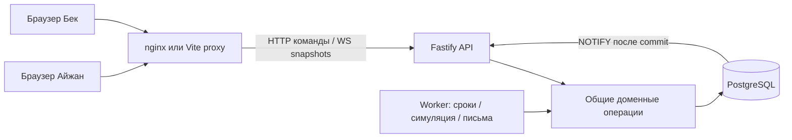

# СамоКеттик — текущая архитектура

Описание соответствует исходникам schema6 после U019. Подготовлено на этапе U021; объём приёмки уточнён U023: auth/Google/KY/external SMTP необязательны, локальный mailbox допустим, одно invoice mail и причина auto-finish обязательны. Первоначальное предложение E0 и его поздние приписки сохранены отдельно: [ARCHITECTURE-PROPOSAL.md](ARCHITECTURE-PROPOSAL.md). Они показывают ход согласования; незавершённые пункты предложения не объявляются реализованными.

## Состав и зависимости

Модульный backend с двумя независимыми процессами из одного кода: Fastify API и worker. Отдельная React SPA общается с API через сеть. npm workspaces без Nx/Turborepo; PostgreSQL — единственное постоянное хранилище. Redis/Kafka, внешняя очередь, микросервисы и PostGIS для этой демонстрации не нужны.



Compose: postgres, одноразовые migrate и seed, worker, api, web. Миграции выполняет один процесс до API; seed сохраняет существующие записи. Зависимости проверяются healthchecks; readiness6 требует БД, schema и свежие reservation/transport heartbeats с тем же config hash. Volumes переживают остановку. Все опубликованные ports — loopback. Worker и API используют одинаковые бизнес-правила.

| Выбор | Причина и фактическое ограничение |
| --- | --- |
| React/TypeScript/Vite | SPA достаточно для карты, SSR не требуется; strict TS и общий DTO package |
| Компонентный Sass | Глобальное требование пользователя, общий набор tokens и отдельные feature styles; Tailwind/shadcn/Radix не установлены |
| Fastify/TypeBox | JSON-schema валидация inputs/responses, те же контракты проверяет браузер; без второй схемы DTO |
| PostgreSQL18/Drizzle/pg | Транзакции, row locks, partial UNIQUE/CHECK/FK/EXCLUDE; SQL критических операций видим в коде |
| ws | Прямой HTTP upgrade, Origin/tickets/heartbeat/slow-consumer cutoff; @fastify/websocket не используется |
| Leaflet/OSM |30 маркеров и GeoJSON, прямой effect+cleanup без react-leaflet; тайлы требуют сеть и attribution |
| Vitest/Playwright | Чистые unit-расчёты, настоящий PG для конкуренции, два независимых browser clients |
| PostgreSQL local mailbox | Приём письма и outbox ack атомарны в одной БД; это не внешний SMTP |

Версии, лицензии, generators и сторонние данные — [DEPENDENCIES.md](DEPENDENCIES.md). Исходные предпочтения отличаются от реализации в UI-стеке и почте; это отражено в решениях, не скрыто.

## Фактическая структура

```text
apps/web/src/
  app/                 # shell и navigation
  api/                 # runtime-validated HTTP/WS client, reconnect
  state/               # useRentalApp, session/pending command intent
  features/map/        # Leaflet и markers
  features/rental/     # карточка брони/поездки
  features/history/    # cursor pages, invoices, demo payment
  i18n/                # RU/KY labels/errors
  ui/                  # dialog, notices, icons, formatting, server clock
  styles/              # tokens/fonts/base/controls, Sass entry
apps/server/src/
  entrypoints/         # api и worker
  config/              # business/env validation, paths, demo identities
  db/                  # schema/client/migrate/seed/check
  modules/auth/        # только demo adapter, временная signed session
  modules/reservations/# fleet/current/reserve/cancel
  modules/trips/       # start/transitions/finalize/billing/geofence/history
  modules/billing/     # demo payment
  modules/simulation/  # elapsed-time GPS/charge
  modules/realtime/    # snapshots/tickets/ws
  jobs/                # deadline scan, transport pipeline, mail, health
apps/server/drizzle/   # SQL0000–0005, metadata и snapshots
packages/contracts/    # TypeBox DTO/error/public config, exports из dist
config/                # demo.json и service-zone.json
scripts/               # setup/dev/check/demo utilities
tests/                # unit/integration/e2e/acceptance/support/helpers
docs/                 # решения, prompts, матрица и реальные evidence
```

Пакет contracts нужно собрать перед host seed/check. Docker build и root verify/dev делают сборку явно. Не используются пустые controller/repository-слои.

## Данные и атомарность

14 таблиц: app_metadata; users; vehicles; rentals; trip_intervals; invoices; demo_payments; notifications; idempotency_requests; job_heartbeats; trip_simulations; mail_outbox; local_mailbox; realtime_tickets.

- `vehicles` хранит e7 координаты, battery basis points и остаток расхода, operational/maintenance, version. Доступность derived из режима/заряда/active rental, отдельного mutable vehicle.status нет.
- `rentals` — единый агрегат брони и поездки: reserved → cancelled/expired либо riding ↔ paused → finished. Partial UNIQUE на vehicle и user для reserved/riding/paused защищают занятость независимо от количества API-процессов. CHECK/FK защищают допустимые поля/сроки/owner.
- `trip_intervals` содержит закрытые/открытый riding/paused интервалы; один открытый и EXCLUDE через btree_gist запрещают пересечение. Rental сохраняет тариф/порог/зону, чтобы смена config не меняла историю.
- Invoice уникален на rental; demo payment уникален на invoice; notification уникален на rental/code; outbox/mailbox уникальны на invoice. Счёт и связанные задания создаются в той же транзакции finish.
- `idempotency_requests` хранит owner/key, fingerprint и HTTP result. Повтор с тем же телом возвращает сохранённый результат, другое тело даёт409. UI сохраняет только pending intent/key, а не авторитетное состояние поездки.

Обычные операции используют READ COMMITTED и блокировки в порядке idempotency → user → vehicle → rental → interval → simulation → invoice/outbox. Время читается из PostgreSQL **после ожидания locks**. Занятость повторно проверяется внутри транзакции; partial UNIQUE остаётся последней защитой. Ошибки конфликтов отображаются понятными409; таймаут/неопределённый ответ допускает replay прежнего key. Внешних вызовов в доменной транзакции нет. Mail worker блокирует только outbox.

Истории: keyset по ended_at/id либо created_at/id DESC, owner filter, limit1–100/default20, nullable nextCursor UUID. Anchor timestamp остаётся в PG, не теряет микросекунды через JS Date. Неизвестный/чужой cursor даёт пустую страницу. Глобальный snapshot на всё листание/count страниц не реализован; новые строки не сдвигают продолжение.

## Время, симуляция и восстановление

Бронь хранит reserved_at/warn_at/expires_at с900/180s из конфигурации. Worker сканирует сохранённые deadlines, после restart обрабатывает просроченные. Дубликаты предупреждений/истечений исключены UNIQUE и locks; если всё окно warning пропущено, устаревшее warning не отправляется. API также корректно освобождает истёкшую бронь перед конфликтующей операцией.

Начало/пауза/продолжение/завершение сначала учитывают старый режим до серверного времени. Симуляция продвигается по elapsed DB time и сохранённым fractional remainder, а не числу callbacks. Движение синтетическое; на паузе GPS неподвижен, расход меньше. При разряде определяется расчётное время0%, закрывается поездка даже вне зоны, создаются invoice/notice/outbox. При потере браузера учёт идёт дальше; после downtime worker догоняет состояние. Политика подробно описана в [SIMULATION-REALTIME.md](SIMULATION-REALTIME.md).

Деньги: PostgreSQL bigint/целые тыйыны, TypeScript BigInt, строки decimal в JSON. Суммы длительностей riding и paused округляются вверх до минут **по каждому режиму отдельно**, затем умножаются на сохранённые800/200. Браузер лишь показывает server cost и countdown; не принимает решение об expiry/finish. См. [BILLING.md](BILLING.md). Polygon/MultiPolygon проверяется сервером по сохранённой зоне; граница включена, holes учитываются, ручной finish снаружи запрещён.

## Realtime, identity и письмо

HTTP — единственный командный интерфейс. Public WS отдаёт fleet, private — owner snapshot. PG NOTIFY после commit и периодическая сверка сигнализируют о необходимости чтения; это не durable event log. Потерянный сигнал компенсируется snapshot/reconnect через API. Используются bounded buffers, heartbeat и reconcile. User IDs/постоянные secrets не попадают в публичный fleet или frontend bundle.

Два общих demo-профиля получают HMAC bearer по разрешённому Origin. Постоянные CLI bearer остаются на host; browser получает временный credential в sessionStorage. Private WS использует одноразовый PG ticket, TTL ограничен credential expiry; connection закрывается при deadline, даже если ticket погасил другой API. **Нет password/Google и production session management.**

Worker принимает invoice mail в local_mailbox и делает outbox ack одной PG-транзакцией, поэтому crash/retry не дублирует локальное письмо. Текст пока RU. SMTP-провайдер/эквайринг не подключены; demo approved/declined не списывает деньги. Нет обещания exactly-once внешнего email.

## Проверка и границы

Unit проверяют billing/geometry/config/client helpers; integration используют реальные PG locks/constraints/HTTP и отдельные базы; Playwright — frontend→API→PG→realtime в независимых контекстах. Deadline/charge/GPS fixtures существуют только в тестовых UUID DB, не в production API. Есть реальный900s acceptance U017 и raw failed/passed runs. Актуальные результаты/незакрытые требования — [SUBMISSION.md](SUBMISSION.md) и [REQUIREMENTS.md](REQUIREMENTS.md).
